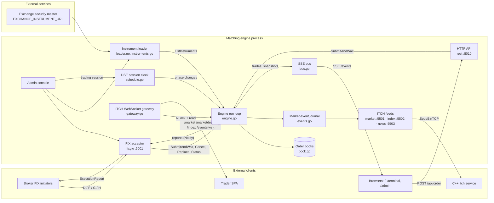

# Architecture

This page explains how the matching engine works inside: the components and how they talk to each other, the path an order takes from arrival to execution report and market data, the matching rules, trading sessions, pre-trade checks, the simulated market participants, persistence, and where the instrument universe comes from. It's written for developers changing the engine and for integrators who need to know exactly how it behaves.

The engine is one Go binary (module `velexa-sim-me`, package `main`). It simulates a Dhaka Stock Exchange matching engine for an order-management system (OMS): brokers send orders over FIX, the engine matches them on in-memory order books, and it publishes market data over ITCH, WebSockets and Server-Sent Events.

## Components



`Serve` in `Cmd/serve.go` (called from `main.go`) wires everything together at startup:

1. Builds the bus, loads the instrument universe, creates the `Engine` with its permanent orderbook ids, starts its run loop and the session clock.
2. Starts the FIX acceptor (a failure is logged; HTTP keeps running) and loads the ITCH credentials.
3. Calls `newServer` (also in `Cmd/serve.go`), which loads the admin audit log and broker metadata, starts the ITCH WebSocket gateway and the three SoupBinTCP feeds (market, index, news).
4. Serves HTTP on `PORT` with the routes registered by `rest/server.go`. Each package under `rest/handlers/` lists its own URLs in `routes.go`, and each URL is a method on that package's `Handler`.

## Concurrency model

- **One goroutine does all matching.** `(*Engine).run` waits on three inputs:
  - `submit`: incoming orders, buffered to 4096.
  - `ctrl`: control functions (cancel, replace, phase change, instrument listing), buffered to 256.
  - A 700 ms ticker that expires GTD orders, recomputes the index and publishes a market snapshot to the SSE bus.
- **The engine lock.** Orders and control functions run while holding `Engine.mu` for writing. HTTP snapshots and the WebSocket gateway take the read lock; the ITCH feeds read the market-event journal, which has its own lock. 
- **Copy-on-write instrument tables.** The book, market-data, instrument-list and order-book-ID tables are held behind `atomic.Pointer`s. Listing a new instrument builds fresh tables and swaps them in, publishing the instrument list last. That way a reader that walks the list without the lock always finds the books and market data for each symbol.
- **Synchronous replies.** `SubmitAndWait` gives each order a reply channel and waits up to 3 s for the first execution report. Later reports, such as a stop order triggering, go through the order's `notify` callback.

## Order lifecycle

1. **Arrival.**
   - FIX: `handleNewOrder` parses the tags, `validateNew` screens them, and the order is created with the actor `FIX:<CompID>`.
   - HTTP: `/api/order` creates a DAY order with the actor `API`, or whatever `actor` field the body supplies.
2. **Unknown symbols.** If the symbol isn't listed and `ME_AUTO_LIST` is on, `autoList` opens a book for it first (see [Instrument universe](#instrument-universe)).
3. **`process`, on the matching goroutine:**
   1. Rejects symbols with no book, halted/delisted/pending instruments and FIX orders that aren't whole market lots.
   2. Rejects a ClOrdID the same broker is already using for a working order (resting or a parked stop).
   3. Runs the [pre-trade checks](#pre-trade-checks-fix-orders-only) on FIX limit and stop-limit prices, in every session.
   4. Gives the order an ID and applies the [session rules](#trading-sessions): nothing is accepted in Close and Closed, only the close price in Post-Close.
   5. Prices a market-at-best order at the best opposite level and treats it as a limit order.
   6. Parks stop and stop-limit orders and replies `PENDING`.
   7. In Pre-Open, rests limit orders without matching and rejects market orders.
   8. Calls `match`, adds board and ISIN to the report, and replies.
   9. Calls `triggerStops` for the symbol.

   Every report about an order also goes to its `Notify` callback, on the matching goroutine: the reply, each fill while it rests, cancel/replace confirmations, a triggered stop and expiry. The FIX gateway queues them and sends them in that order.
4. **Market data.** Each trade goes through `recordTrade`, which:
   - updates the instrument's last, high, low, volume and trade count (the day's first trade sets open, high and low)
   - keeps the trade in a 500-entry log of recent trades
   - publishes a `trade` event on the SSE bus

   `refreshTop` then updates best bid and ask.
5. **Distribution.**
   - The FIX acceptor turns each report into DSE-style ExecutionReports (ack, one per trade, …), see [protocols](protocols.md#outbound-executionreport-358).
   - Every change to the book is appended to the market-event journal (`engine/events.go`); the ITCH market feed streams it as it happens.
   - The SSE bus pushes snapshots every 700 ms.
   - The WebSocket gateway takes a snapshot every 500 ms.

## Matching rules

All matching code is in `engine/engine.go` (`match`, `consumeFront`, `triggerStops`, `uncross`) and `engine/book.go`.

- **Price-time priority.** Each side of a book is a sorted list of price levels, best first. Each level is a first-in-first-out queue. Prices are stored as integer hundredths (`px2k`), so the engine works to 2 decimal places.
- **Trade price.** A trade happens at the resting order's price.
- **Limit orders** match while they cross the best opposite price. Any remainder rests if its time-in-force allows.
- **Market orders** sweep the opposite side and never rest. Anything unfilled is dropped. A market order that fills nothing is `REJECTED` with `no liquidity: …`. One that fills partly is reported as `PARTIALLY_FILLED` with nothing left on the book.

| Time-in-force | Behaviour |
|---|---|
| DAY (default) | Rests until the end of the trading day, then expires with a 150=C report. |
| GTC | Rests until cancelled. |
| IOC | Fills what it can now; the rest is cancelled. Nothing filled means `CANCELED`. |
| FOK | `canFill` first checks, without changing the book, whether the whole quantity can fill now. If not, the order is `CANCELED` and nothing trades. |
| GTD | Rests until its expiry time. Every 700 ms, `sweepExpired` removes expired orders and reports them (150=C). |

- **Stop and stop-limit orders** wait off the book in a per-symbol list. After each order on that symbol is processed (and after a replace or the market opening), `triggerStops` fires any stop whose trigger has been reached:
  - a buy stop fires when the last price is at or above StopPx
  - a sell stop fires when the last price is at or below StopPx

  A stop becomes a market order; a stop-limit becomes a limit order at its Price. The triggered order is matched and its report goes to the order's `notify` callback. One triggered stop can move the price and fire others.
- **Icebergs.** With MaxFloor (tag 111) set, only that much shows on the book; the rest is held back. When the visible slice fills, the next slice is shown and moves to the back of the queue, so it loses time priority. The held-back quantity counts in LeavesQty.
- **Cancel** removes a resting order or a parked stop by ClOrdID. Working orders are indexed by owner and ClOrdID (`openKey`), so two brokers may use the same ClOrdID and each can only reach its own order.
- **Replace** first checks the amend like a new order: the market must be accepting orders (not Close/Closed), the new ClOrdID must not belong to another working order, the new quantity must be whole lots, and a new price must pass the tick and band checks. A refused amend leaves the order untouched. Otherwise it pulls the order, sets the new total quantity (unchanged when OrderQty is missing) and price, and matches it again. This resets its time priority. See [protocols](protocols.md#ordercancelreplacerequest-35g) for the reports it produces.

## Pre-trade checks (FIX orders only)

`priceReason` checks the price of FIX limit and stop-limit orders (actor starting `FIX:`) — on new orders in every session, the Pre-Open auction included, and on amends. Market orders and `/api/order` orders skip these checks.

1. **Tick size.** The price must be a multiple of the instrument's tick, taken from the security master. If the master doesn't give a tick, the default is `0.10` (`defaultTick`).
2. **Price band.** The DSE daily circuit breaker. It's anchored on the previous close, or the last price if there's no previous close. The band width depends on that anchor (`bandPctFor`):

| Anchor price (Tk) | Band |
|---|---|
| ≤ 200 | ±10% |
| ≤ 500 | ±8.75% |
| ≤ 1000 | ±7.5% |
| ≤ 2000 | ±6.25% |
| ≤ 5000 | ±5% |
| > 5000 | ±3.75% |

The band limits are rounded to 2 decimals. A rejection gives the board, ISIN, band and limits in the reason text.

## Trading sessions

The trading day follows the DSE clock (Asia/Dhaka, Sunday to Thursday) by default, from `engine/schedule.go`:

| Phase | From (default) | Orders | Housekeeping on entry |
|---|---|---|---|
| Closed | 15:00 to 09:30, Friday, Saturday | rejected: `(293): Orders are not being accepted at this time` | day orders expire (150=C); `S` codes `E` and `C` |
| Pre-Open | 09:30 | limit orders rest without matching; market orders rejected | leaving Closed starts a new trading day: yesterday's close becomes the reference price, the day's figures reset, new reference prices on the feed |
| Continuous Trading | 10:00 | normal matching | coming from Pre-Open: the opening auction (`uncross`) |
| Close | 14:30 | rejected (293) | closing prices published (`Q`) |
| Post-Close | 14:40 | only at the close price; market orders trade at it, other prices are rejected `(1116): Order price is not equal to close price` | |

The times are `ME_SESSION_SCHEDULE` (`09:30,10:00,14:30,14:40,15:00`); public holidays are not known. If the engine starts or wakes up mid-day it steps through the phases it missed, so their housekeeping still runs.

**Manual control.** The admin console (Market Session page) and `/api/session/preopen|open` can force a phase; forcing switches the clock off ("Manual"). "Follow schedule" switches it back on, and `ME_SESSION_AUTO=off` starts the engine with the clock off.

**Opening auction.** On Pre-Open → Continuous Trading, `uncross` runs for every instrument, then `triggerStops`:
1. Considers every bid and ask price level as a possible opening price.
2. Picks the price where the most volume can trade: the smaller of the total bid quantity at or above the price and the total ask quantity at or below it. Ties go to the price closest to the instrument's reference price.
3. Trades crossing orders at that one price until the volume is used up. Both sides get a fill report, and the feed sends `C` for each.

## Market data and the index

Each instrument has a `MarketData` record: previous close, open, last, high, low, change, change %, best bid and ask with sizes, volume and trade count. While an instrument hasn't traded today, its open, last, high and low all equal the previous close; the first trade sets them.

The index is a DSEX-style index on a base of 6000:

```text
index = 6000 × Σ(last price) / Σ(previous close)
```

It's recomputed every 700 ms across all instruments. The `/index` WebSocket stream reports its change against 6000. The ITCH index feed publishes DSEX and DS30 (the 30 highest-priced equities) as `Z` messages, see [protocols](protocols.md#index-feed).

## Order flow

There are no simulated traders: every order comes from a broker over FIX, or from the Trade Terminal / `/api/order`. Books start empty each day and fill only with real orders, so prices move only when real orders trade, as on the DSE.

## Persistence

The engine matches in memory and saves the live market every second (`database/marketstate`):

- **The snapshot** (`engine.TakeSnapshot`): every resting order in its queue position (per book: bids best to worst, then asks, each level oldest first), with its filled quantity, iceberg reserve, validity and the gateway's context (FIX session, echoed fields, OrderID); parked stops; each instrument's last, open, high, low, previous close, volume and trade count; the trade tape; the order and trade numbers; the session phase and whether the clock is on. It is taken under the engine's read lock only when the market changed (a dirty flag set by the matching loop), and saved to `engine_state` / `engine_state.json`.
- **The trade log**: `engine.OnTrade` hands every execution, with both sides, to the saver, which writes it to `trade_log` / `trades/*.jsonl` every second. The snapshot is taken before the trades are written, so the log always covers every trade the snapshot shows.
- **The FIX outbox**: reports for a broker that is logged off wait, in order, and are sent when it logs on again (`fixgw/persist.go`); they are saved with the market.

On start, `Cmd/serve.go` restores the snapshot before the matching loop runs (`engine.Restore`: `Book.Rest` in the saved order keeps time priority, bid/ask and the index are recomputed), re-attaches the restored FIX orders to the acceptor (`AttachNotify`), puts back the outbox, and then starts the clock. A snapshot from an earlier day first runs that day's close (closing prices, expiry of day orders), so the clock opens the new day from the right reference prices. Order and trade numbers continue after the highest in the snapshot, the order log and the trade log. At shutdown the acceptor stops first, then the market is saved once more.

The ITCH journal is not saved: after a restart the feed starts a new session, and its start-of-day snapshot carries the restored book.

Also kept across restarts:

- configuration files edited from the admin console (credentials, broker metadata, the IP allowlist, imported instrument masters)
- the permanent orderbook ids (`orderbook_ids.json`)
- console accounts, the audit trail, the daily report figures and the order log (PostgreSQL, or files without a database)
- the FIX message log

## Instrument universe

`loadUniverse` in `engine/loader.go` decides which instruments the engine trades, trying each source in order:

1. **`ME_INSTRUMENT_FILE`**, an operator-supplied master. If it exists and parses to at least one tradeable instrument, it wins.
2. **`EXCHANGE_INSTRUMENT_URL`**, fetched with a 12-second timeout. It's used only if it gives at least 50 tradeable instruments; fewer means the exchange hasn't imported its end-of-day file yet.
3. **The built-in list**: 430 real DSE tickers in `engine/universe_data.go` (`universe`) from the DSE end-of-day ticker file of 14 Sep 2023 — 374 equities, 36 mutual funds, 12 corporate bonds and 8 debentures at their closing prices. Class, category, sector and ISIN come from `refdata/dse.go`.

If the instrument file holds an explicitly empty list (`{"instruments": []}` or `[]`, as saved when every instrument has been removed), the engine starts with **no instruments** and does not fall back to the built-in list; list instruments on the console's Instruments page. A file that has rows but none usable is still treated as broken.

The chosen source is shown as `universe.source` in `/api/status` and the admin console.

`buildUniverse` skips the following rows:
- indices (`is_index`)
- rows with status `halted` or `delisted`
- duplicates
- symbols that fail `validSymbol` (1–20 characters from `A–Z`, `0–9`, `.`, `-` and `_`)

Missing values are filled in: previous close becomes 100, tick becomes `0.10`, board becomes `MAIN`, and name becomes the symbol. Each instrument's board, ISIN and tick are stored in `instrMeta` and used by the pre-trade checks, the ExecutionReport extras and the board labels on the WebSocket stream.

**Changing the universe at runtime.** `(*Engine).ListInstruments` merges a master into the running engine:
- New symbols get a book, market data and the next order book ID, and appear on the ITCH market feed.
- Symbols already listed have their name and previous close updated. If they haven't traded yet, their prices are reset to the new previous close.

The admin console starts this with **reload** (read the configured sources again) or **import** (upload a master). See [http-api](http-api.md#admin-console-api).

**Auto-listing.** When `ME_AUTO_LIST` is on (the default) and an order arrives for a well-formed but unknown symbol, `autoList` opens a book on the spot:
- The reference price is the order's price, or its StopPx, or 100 if neither is set.
- The board is `MAIN` and the tick is `0.10`.
- A log line `[universe] AUTO-LISTED …` is written.

Symbols listed this way appear in `/admin/api/instruments` as `auto_listed`. Auto-listed symbols mean the loaded master is behind the OMS's; importing the real master fixes their previous close and tick.
