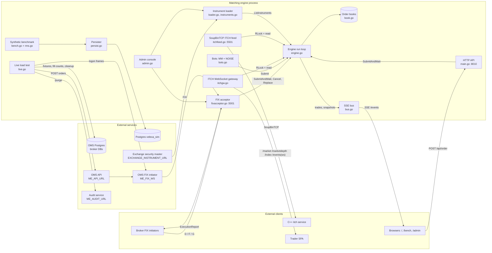

# Architecture

This page explains how the matching engine works inside: the components and how they talk to each other, the path an order takes from arrival to execution report and market data, the matching rules, trading sessions, pre-trade checks, the simulated market participants, persistence, and where the instrument universe comes from. It's written for developers changing the engine and for integrators who need to know exactly how it behaves.

The engine is one Go binary (module `velexa-sim-me`, package `main`). It simulates a Dhaka Stock Exchange matching engine for an order-management system (OMS): brokers send orders over FIX, the engine matches them on in-memory order books, and it publishes market data over ITCH, WebSockets and Server-Sent Events.

## Components



`Serve` in `Cmd/serve.go` (called from `main.go`) wires everything together at startup:

1. Builds the bus, loads the instrument universe, creates the `Engine`, and starts its run loop and the bots.
2. Starts the FIX acceptor (a failure is logged; HTTP keeps running) and loads the ITCH credentials.
3. Calls `newServer` (also in `Cmd/serve.go`), which loads the admin audit log and broker metadata, starts the ITCH WebSocket gateway and the SoupBinTCP feed, creates the Postgres pool for the benchmark (connections open lazily) and the benchmark and load-test objects.
4. Serves HTTP on `PORT` with the routes registered by `rest/server.go`. Each package under `rest/handlers/` lists its own URLs in `routes.go`, and each URL is a method on that package's `Handler`.

## Concurrency model

- **One goroutine does all matching.** `(*Engine).run` waits on three inputs:
  - `submit`: incoming orders, buffered to 4096.
  - `ctrl`: control functions (cancel, replace, phase change, instrument listing), buffered to 256.
  - A 700 ms ticker that expires GTD orders, recomputes the index and publishes a market snapshot to the SSE bus.
- **The engine lock.** Orders and control functions run while holding `Engine.mu` for writing. HTTP snapshots, the ITCH feed and the WebSocket gateway take the read lock. The market-maker bots also take the write lock briefly to move their fair value and pull their own quotes.
- **Copy-on-write instrument tables.** The book, market-data, instrument-list and order-book-ID tables are held behind `atomic.Pointer`s. Listing a new instrument builds fresh tables and swaps them in, publishing the instrument list last. That way a reader that walks the list without the lock always finds the books and market data for each symbol.
- **Synchronous replies.** `SubmitAndWait` gives each order a reply channel and waits up to 3 s for the first execution report. Later reports, such as a stop order triggering, go through the order's `notify` callback.

## Order lifecycle

1. **Arrival.**
   - FIX: `handleNewOrder` parses the tags, `validateNew` screens them, and the order is created with the actor `FIX:<CompID>`.
   - HTTP: `/api/order` creates a DAY order with the actor `API`, or whatever `actor` field the body supplies.
   - Bots call `Submit` without waiting for a reply.
2. **Unknown symbols.** If the symbol isn't listed and `ME_AUTO_LIST` is on, `autoList` opens a book for it first (see [Instrument universe](#instrument-universe)).
3. **`process`, on the matching goroutine:**
   1. Rejects symbols with no book, then gives the order an ID.
   2. Parks stop and stop-limit orders and replies `PENDING`.
   3. In Pre-Open, rests limit orders without matching and rejects market orders.
   4. Runs the [pre-trade checks](#pre-trade-checks-fix-orders-only) on FIX limit orders.
   5. Calls `match`, adds board and ISIN to the report, and replies.
   6. Calls `triggerStops` for the symbol.
4. **Market data.** Each trade goes through `recordTrade`, which:
   - updates the instrument's last, high, low, volume and trade count
   - keeps the trade in a 500-entry log of recent trades
   - publishes a `trade` event on the SSE bus

   `refreshTop` then updates best bid and ask.
5. **Distribution.**
   - The FIX acceptor turns the report into an ExecutionReport.
   - The SSE bus pushes snapshots every 700 ms.
   - The WebSocket gateway takes a snapshot every 500 ms.
   - Each ITCH session publishes new trades and depth every 700 ms.

## Matching rules

All matching code is in `engine/engine.go` (`match`, `consumeFront`, `triggerStops`, `uncross`) and `engine/book.go`.

- **Price-time priority.** Each side of a book is a sorted list of price levels, best first. Each level is a first-in-first-out queue. Prices are stored as integer hundredths (`px2k`), so the engine works to 2 decimal places.
- **Trade price.** A trade happens at the resting order's price.
- **Limit orders** match while they cross the best opposite price. Any remainder rests if its time-in-force allows.
- **Market orders** sweep the opposite side and never rest. Anything unfilled is dropped. A market order that fills nothing is `REJECTED` with `no liquidity: …`. One that fills partly is reported as `PARTIALLY_FILLED` with nothing left on the book.

| Time-in-force | Behaviour |
|---|---|
| DAY (default) | Rests until cancelled. There is no end-of-day, so DAY behaves like GTC. |
| GTC | Rests until cancelled. |
| IOC | Fills what it can now; the rest is cancelled. Nothing filled means `CANCELED`. |
| FOK | `canFill` first checks, without changing the book, whether the whole quantity can fill now. If not, the order is `CANCELED` and nothing trades. |
| GTD | Rests until its expiry time. Every 700 ms, `sweepExpired` removes expired orders without sending any report. |

- **Stop and stop-limit orders** wait off the book in a per-symbol list. After each order on that symbol is processed (and after a replace or the market opening), `triggerStops` fires any stop whose trigger has been reached:
  - a buy stop fires when the last price is at or above StopPx
  - a sell stop fires when the last price is at or below StopPx

  A stop becomes a market order; a stop-limit becomes a limit order at its Price. The triggered order is matched and its report goes to the order's `notify` callback. One triggered stop can move the price and fire others.
- **Icebergs.** With MaxFloor (tag 111) set, only that much shows on the book; the rest is held back. When the visible slice fills, the next slice is shown and moves to the back of the queue, so it loses time priority. The held-back quantity counts in LeavesQty.
- **Cancel** removes a resting order or a parked stop by ClOrdID.
- **Replace** pulls the order, sets the new total quantity and price, and matches it again. This resets its time priority. See [protocols](protocols.md#ordercancelreplacerequest-35g) for the reports it produces.

## Pre-trade checks (FIX orders only)

`process` checks FIX limit orders with a price above 0 (actor starting `FIX:`). Market orders, bot orders and `/api/order` orders skip these checks.

1. **Tick size.** The price must be a multiple of the instrument's tick, taken from the security master. If the master doesn't give a tick, the default is `0.10` (`defaultTick`).
2. **Price band.** The DSE daily circuit breaker. It's anchored on the previous close, or the last price if there's no previous close. The band width depends on that anchor (`bandPctFor`):

| Anchor price (Tk) | Band |
|---|---|
| ≤ 200 | ±10% |
| ≤ 500 | ±8.75% |
| ≤ 1000 | ±7.5% |
| ≤ 2000 | ±6.25% |
| ≤ 5000 | ±5% |
| > 5000 | ±3.75% |

The band limits are rounded to 2 decimals. A rejection gives the board, ISIN, band and limits in the reason text.

## Trading sessions

The session phase starts as `Continuous Trading`. It can be switched through `/api/session/*` or the admin console.

- **Pre-Open (call auction).**
  - Limit orders rest on the book without matching.
  - Market orders are rejected.
  - Stop orders are still parked as usual.

  The bots keep quoting during Pre-Open unless they're paused, so the books keep filling up.
- **Opening: Pre-Open → Continuous Trading.** `SetPhase` runs `uncross` for every instrument, then `triggerStops`. `uncross` does the following:
  1. Considers every bid and ask price level as a possible opening price.
  2. Picks the price where the most volume can trade: the smaller of the total bid quantity at or above the price and the total ask quantity at or below it. Ties go to the price closest to the instrument's reference price.
  3. Trades crossing orders at that one price until the volume is used up. These auction trades are recorded with the aggressor `BUY`.
- There is no closing auction or end-of-day processing.

The engine also has a `running` flag that rejects orders with `matching engine is halted` when false. No code path in the current version sets it to false.

## Market data and the index

Each instrument has a `MarketData` record: previous close, open, last, high, low, change, change %, best bid and ask with sizes, volume and trade count. While an instrument hasn't traded, its open, last, high and low all equal the previous close.

The index is a DSEX-style index on a base of 6000:

```text
index = 6000 × Σ(last price) / Σ(previous close)
```

It's recomputed every 700 ms across all instruments. The `/index` WebSocket stream reports its change against 6000.

## Simulated market participants (bots)

`startBots` in `engine/bots.go` starts two goroutines per instrument at boot. Instruments listed later by auto-listing or an import get them too (`startBotsFor`).

| Bot | Actor | Behaviour |
|---|---|---|
| Market maker | `MM` | Every 0.8–1.5 s:<br>1. Moves its fair value toward the previous close (2% mean reversion plus random noise), kept within ±15% of the previous close.<br>2. Cancels all its own orders.<br>3. Quotes 5 bid and 5 ask levels, one tick apart, using its own price-based tick ladder (`tickSize`: Tk 0.50 at or above 200, 0.20 at or above 50, 0.10 at or above 10, otherwise 0.05). |
| Noise trader | `NOISE` | Every 0.6–2.4 s, sends a market order for 100–699 shares on a random side. This produces trades and moves the price. |

`/api/bots/pause` sets a flag that makes both bots skip their turns; their goroutines keep running. Bot orders skip the FIX pre-trade checks.

The bots' tick ladder is a market-making shortcut and is separate from the exchange tick used for the FIX checks. The comment on `defaultTick` explains why the two must stay separate.

## Risk management (RMS)

`RiskEngine` in `loadtest/rms.go` is used **only by the synthetic benchmark**; live orders never go through it. Its checks, in order:

| Code | Rule |
|---|---|
| `TRADING_HALTED` | Per-symbol halt flag (none are set). |
| `QTY_LIMIT` | Quantity is 0 or less, or more than 1,000,000. |
| `PRICE_BAND` | Limit price more than ±10% from the reference price. |
| `VALUE_LIMIT` | Order value over 50,000,000. |
| `BUYING_POWER` | Buy order value over the account's limit (no limits are set). |
| `POSITION_LIMIT` | Quantity over 5,000,000. |

## Persistence

The live engine keeps everything in memory. Books, resting orders, trades and market data are lost on restart, and every instrument restarts from its previous close. What does survive a restart:

- configuration files edited from the admin console (credentials, broker metadata, the IP allowlist and imported instrument masters)
- the admin audit log
- the FIX message log

Only the synthetic benchmark writes to Postgres. `Persister` in `loadtest/persist.go` copies rows into the `UNLOGGED` tables `sim_orders` and `sim_execs` in the `velexa_sim` database, in batches of up to 3000 rows or every 40 ms. Columns written:

- `sim_orders`: `id, cl_ord_id, account, symbol, side, qty, price, status, reject_reason, rms_ns, match_ns`. `/api/bench/orders.csv` also reads a `ts` column.
- `sim_execs`: `exec_id, order_id, symbol, side, last_px, last_qty, cum_qty, status`

The SQL that creates these tables isn't in this repository.

## Instrument universe

`loadUniverse` in `engine/loader.go` decides which instruments the engine trades, trying each source in order:

1. **`ME_INSTRUMENT_FILE`**, an operator-supplied master. If it exists and parses to at least one tradeable instrument, it wins.
2. **`EXCHANGE_INSTRUMENT_URL`**, fetched with a 12-second timeout. It's used only if it gives at least 50 tradeable instruments; fewer means the exchange hasn't imported its end-of-day file yet.
3. **The built-in list**: 430 real DSE tickers in `engine/universe_data.go` (`universe`) from the DSE end-of-day ticker file of 14 Sep 2023 — 374 equities, 36 mutual funds, 12 corporate bonds and 8 debentures at their closing prices. Class, category, sector and ISIN come from `refdata/dse.go`.

The chosen source is shown as `universe.source` in `/api/status` and the admin console.

`buildUniverse` skips the following rows:
- indices (`is_index`)
- rows with status `halted` or `delisted`
- duplicates
- symbols that fail `validSymbol` (1–20 characters from `A–Z`, `0–9`, `.`, `-` and `_`)

Missing values are filled in: previous close becomes 100, tick becomes `0.10`, board becomes `MAIN`, and name becomes the symbol. Each instrument's board, ISIN and tick are stored in `instrMeta` and used by the pre-trade checks, the ExecutionReport extras and the board labels on the WebSocket stream.

**Changing the universe at runtime.** `(*Engine).ListInstruments` merges a master into the running engine:
- New symbols get a book, market data, the next order book ID and their own bots.
- Symbols already listed have their name and previous close updated. If they haven't traded yet, their prices are reset to the new previous close.

The admin console starts this with **reload** (read the configured sources again) or **import** (upload a master). See [http-api](http-api.md#admin-console-api).

**Auto-listing.** When `ME_AUTO_LIST` is on (the default) and an order arrives for a well-formed but unknown symbol, `autoList` opens a book on the spot:
- The reference price is the order's price, or its StopPx, or 100 if neither is set.
- The board is `MAIN` and the tick is `0.10`.
- A log line `[universe] AUTO-LISTED …` is written.

Symbols listed this way appear in `/admin/api/instruments` as `auto_listed`. Auto-listed symbols mean the loaded master is behind the OMS's; importing the real master fixes their previous close and tick.
